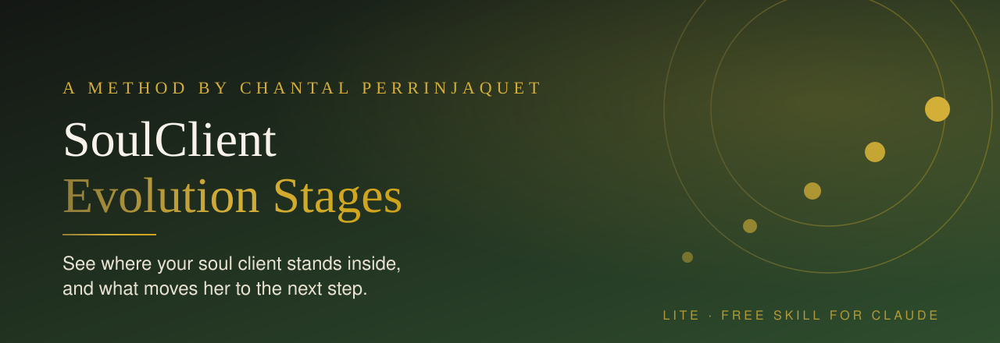
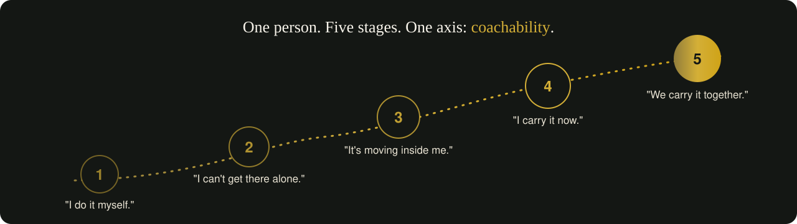
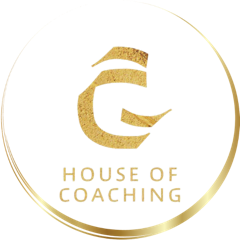

<p align="center">
  
</p>

<p align="center">
  
  
  
</p>

<h3 align="center">You feel where your client stands.<br>Now you can see it, name it and speak to it.</h3>

---

## 💭 Does this sound familiar?

- A client knows your offer inside out, and still she does not book.
- Someone watches you silently for months, then suddenly buys your biggest program.
- Your content speaks to everyone at once, and so it moves no one deeply.

You do not need another funnel. You need to see **where she stands inside**.

---

## ✨ What the skill does for you

You describe your ideal client and your offers. In a few minutes the skill maps **one person on her inner path**, from *"I do it myself"* to *"we carry it together"*.

<p align="center">
  
</p>

| | You get |
|---|---|
| 🧭 | **Her coachability status** at every stage |
| 🌊 | **What changes inside her** from one stage to the next |
| 👀 | **One signal you can actually observe**: in comments, DMs and purchases |
| 🚪 | **Your key window**: the moment she either allows guidance or buys elsewhere |

---

## 🔍 This is not Eugene Schwartz

| | Schwartz: 5 Stages of Awareness | SoulClient Evolution Stages |
|---|---|---|
| **Sorts by** | How close someone is to buying a product | How ready she is to be mirrored and guided |
| **Asks** | "Does she know my offer?" | "Can she let herself be seen?" |
| **Built for** | Copywriting and sales pages | Coaches, healers and mentors who work with depth |

- A client can know your product perfectly and still not be coachable.
- Her revenue, age or profession never decide her stage. Her inner movement does.
- Every stage is a soul client. She simply buys at a different moment and needs different words.
- She may skip stages. A sensitive client often sees a later goal early.

---

## 🚀 Start in two minutes

**Claude Code**
1. Copy the folder `soulclient-evolution-lite/` into `~/.claude/skills/`
2. Type:
```
/soulclient-evolution-lite
```

**Claude.ai (Projects / Skills)**
1. Upload the folder `soulclient-evolution-lite/` as a skill
2. Ask: *"Map the SoulClient Evolution Stages for my ideal client."*

Have ready: a short description of your ideal client and your offers. Want to see the result first? Look at the fictional example: [`references/example.md`](soulclient-evolution-lite/references/example.md)

---

## 💎 Ready to go deeper? The full version

The Lite version shows you **where** she stands. The full **SoulClient Evolution Stages** show you **how to meet her there**, stage by stage:

| | Lite (this repo) | Full version |
|---|:---:|:---:|
| The five stages and the coachability axis | ✅ | ✅ |
| One observable signal per stage | ✅ | ✅ |
| Her emotional identity, in her own inner sentences | | ✅ |
| How she tests you before she opens up | | ✅ |
| What she buys from **your** offer ladder | | ✅ |
| Example lines that mirror, name and invite | | ✅ |
| Recognition system for comments, community and DMs | | ✅ |
| Content mix across all five stages + the path through your offers | | ✅ |

<p align="center">
  <a href="https://deineuniquesoulmission.substack.com"></a>
</p>

---

## 🌿 Created by Chantal Perrinjaquet

<p align="center">
  
</p>

<p align="center">
  <b>SoulStrategy Architect · Medium · House of Coaching</b><br>
  23 years in business. I decode the unique perception of successful spiritual entrepreneurs<br>
  and help them turn it into their own method, deeper groups and a team that carries their values.
</p>

<p align="center">
  <a href="https://bit.ly/My-SoulMission"></a>
  <a href="https://www.skool.com/soulcalling-portal-1290/about"></a>
</p>

---

## License

© 2026 Chantal Perrinjaquet. This Lite version is licensed under [CC BY-NC-ND 4.0](https://creativecommons.org/licenses/by-nc-nd/4.0/): you may use and share it unchanged, with credit to Chantal Perrinjaquet, for non-commercial purposes. No adapted versions. The full SoulClient Evolution Stages are not part of this repository and are not licensed for redistribution. Licensing for teams and partners: write **SKILLS** on [WhatsApp](https://bit.ly/My-SoulMission).
